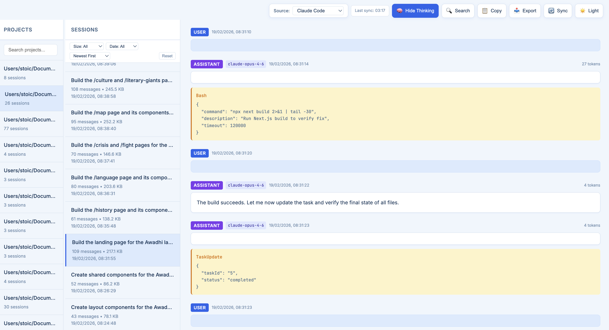
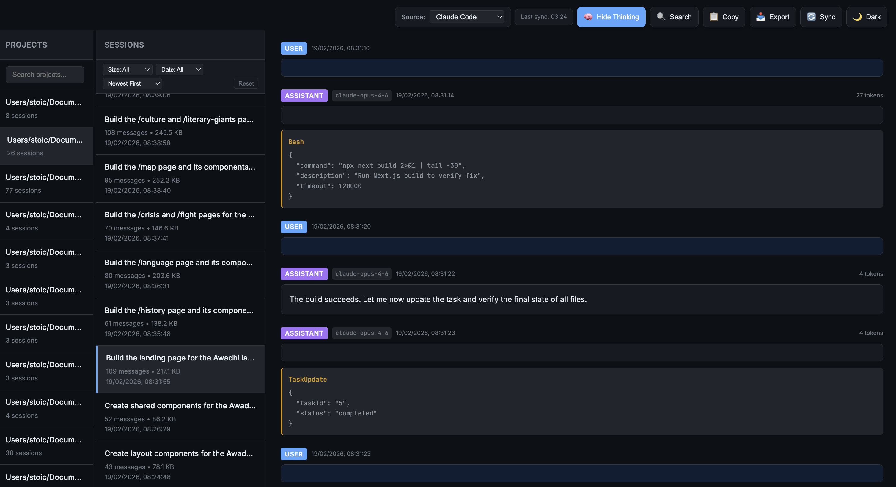

<div align="center">
  <div align="center">

</div>

<div align="center">

<h3>Your AI coding agent just edited 30 files across 6 directories.<br>What actually happened?</h3>

<p>
Browse every session from Claude Code, OpenAI Codex, and Gemini CLI
the thinking, the tool calls, the file changes, the token costs.
All in one local interface. Nothing leaves your machine.
</p>

</div>

<p>
  <a href="#features">Features</a> •
  <a href="#supported-tools">Supported Tools</a> •
  <a href="#installation">Installation</a> •
  <a href="#usage">Usage</a> •
  <a href="#screenshots">Screenshots</a>
</p>

<p>
  
  
  
  <a href="http://makeapullrequest.com">
    
  </a>
</p>
</div>

<!-- <div align="center">
<table>
<tr>
<td align="center">
<br>
<sub><b>Claude Code</b></sub>
</td>
<td align="center">
<br>
<sub><b>OpenAI Codex</b></sub>
</td>
<td align="center">
<br>
<sub><b>Gemini CLI</b></sub>
</td>
</tr>
</table>
</div> -->

---

| Light Mode | Dark Mode |
|------------|-----------|
|  |  |


---

## ✨ What's New

### 🎨 A redesigned, much lighter portal

A clean Material-style interface, rebuilt so the browser only ever holds what you are looking at:

<table>
<tr>
<td>🧠</td>
<td><b>Huge sessions stay light</b><br>Only the messages on screen are rendered. "Load all" on a 22,751-message session used to build <b>222,310 DOM nodes</b> in 11 seconds; it now loads in <b>0.6s</b> with about <b>2,800</b> nodes, and scrolling stays smooth the whole way through.</td>
</tr>
<tr>
<td>💤</td>
<td><b>Idle tabs give their memory back</b><br>Like a browser's memory saver: leave a tab unused for 5 minutes and it drops everything it loaded (29 MB → 3.4 MB in our test), keeping only where you were. Come back and it reloads just that spot — same message, same scroll position. The server does the same with its caches.</td>
</tr>
<tr>
<td>🚀</td>
<td><b>Faster to open</b><br>40 requests per page load became 4, with no external font downloads. Assets are cached permanently, so a repeat visit fetches nothing but your data.</td>
</tr>
<tr>
<td>🔍</td>
<td><b>Search that keeps up with typing</b><br>Common words that took over a second in full-text search now answer in about <b>70 ms</b>. A Spotlight-style ⌘K dialog with keyboard navigation opens a result right at the matching message.</td>
</tr>
<tr>
<td>🎯</td>
<td><b>Find in conversation, properly</b><br>⌘F or <kbd>/</kbd> searches every loaded message (not just what happens to be rendered), highlights the words in place, and steps through matches with Enter.</td>
</tr>
<tr>
<td>🧹</td>
<td><b>Filters that compose</b><br>You / Assistant / Tools / Unique only / date range all work together, and changing one never throws you back to the top. Your view preferences are remembered.</td>
</tr>
<tr>
<td>🌗</td>
<td><b>Light and dark that follow your system</b><br>A consistent icon set instead of emoji, a sticky toolbar, contextual jump-to-top/bottom buttons, and a project drawer on narrow windows.</td>
</tr>
</table>

### Earlier in this release

A big round of performance, search and correctness work. Highlights:

<table>
<tr>
<td>🔎</td>
<td><b>Full-text search inside conversations</b><br>Search what was actually said and done, not just session titles — powered by SQLite FTS5 with ranked results, highlighted snippets, and a click straight to the matching message. Opt-in, and it shows the index size before building.</td>
</tr>
<tr>
<td>⚡</td>
<td><b>Everything got dramatically faster</b><br>Opening a large project went from <b>15.5s → 0.25s</b>. A search that used to scan the whole corpus for 15.8s now answers in <b>11ms</b>. One slow request no longer freezes the entire app.</td>
</tr>
<tr>
<td>🪶</td>
<td><b>Loads only what's on screen</b><br>Sessions and messages are fetched on demand instead of all at once, so memory stays around <b>22MB</b> no matter how big your history gets. Opening a 966MB session used to need 604MB of RAM — now it's 68MB.</td>
</tr>
<tr>
<td>📊</td>
<td><b>Usage analytics</b><br>Token spend by day, project, model and tool. Now counts <b>cache reads and cache writes</b> — the old totals left them out, under-reporting real usage by over 100x.</td>
</tr>
<tr>
<td>🗂️</td>
<td><b>File-edit archaeology</b><br>"When did an agent last touch <code>auth.py</code>?" Search every session for a file and jump to the exact edit.</td>
</tr>
<tr>
<td>▶️</td>
<td><b>Jump back into a session</b><br>One click copies <code>cd &lt;project&gt; &amp;&amp; claude --resume &lt;id&gt;</code> so you can pick up where you left off, plus a copy-to-open-in-editor command.</td>
</tr>
<tr>
<td>📝</td>
<td><b>Markdown export</b><br>Export a conversation as Markdown — fenced code blocks, collapsible thinking and tool calls — ready to paste into an issue or PR.</td>
</tr>
<tr>
<td>♊</td>
<td><b>Gemini CLI works again</b><br>Gemini changed its log format and the source had gone quietly empty. Fully re-supported — and the app now warns you when a source has files it can't read, instead of just showing nothing.</td>
</tr>
<tr>
<td>🔗</td>
<td><b>Shareable links and a working back button</b><br>Every project and session has its own URL. Refresh keeps your place, and browser back/forward behave.</td>
</tr>
<tr>
<td>🔒</td>
<td><b>Security fixes</b><br>Removed a permissive CORS policy that let any website you visited read your local conversation history. Startup no longer force-kills unrelated processes holding the port, and binding to a non-loopback <code>--host</code> now warns loudly.</td>
</tr>
<tr>
<td>🛟</td>
<td><b>Your data is safer</b><br>Bookmarks and project settings are written atomically with backups, and a corrupt file is quarantined rather than silently reset to empty. Sync never removes a backup before its replacement is safely in place.</td>
</tr>
</table>

> **Upgrading from PyPI?** Markdown rendering and syntax highlighting were silently broken
> in earlier published versions — the packaged wheel was missing its bundled JavaScript.
> Fixed, and now guarded by a test.


## Installation

### Via uv tool (Recommended)

[uv](https://github.com/astral-sh/uv) is a fast Python package installer. Install it first if you haven't:

```bash
curl -LsSf https://astral.sh/uv/install.sh | sh
```

Then install clicodelog as an isolated tool:

```bash
uv tool install clicodelog
```

To upgrade:
```bash
uv tool upgrade clicodelog
```

### Via pip

```bash
pip install clicodelog
```

### From source

```bash
git clone https://github.com/monk1337/clicodelog.git
cd clicodelog
uv tool install -e .
# or with pip:
pip install -e .
```

---

## Usage

After installation, simply run:

```bash
clicodelog
```

The app will:
- Auto-kill any process on port **6126** (if occupied)
- Sync data from all AI coding agent sources
- Start a web server at **http://localhost:6126**

### Command Options

```bash
clicodelog --help               # Show all options
clicodelog --port 8080          # Use custom port
clicodelog --host 0.0.0.0       # Bind to all interfaces
clicodelog --no-sync            # Skip initial data sync
clicodelog --debug              # Run in debug mode
```

### Alternative: Run from source

```bash
git clone https://github.com/monk1337/clicodelog.git
cd clicodelog
python -m clicodelog.cli
```

## Why Developers Use It

<table>
<tr>
<td>🧠</td>
<td><b>See the full chain of reasoning</b><br>Read the agent's thinking blocks, tool calls, and decisions in a clean conversation view. No more squinting at raw JSONL.</td>
</tr>
<tr>
<td>🔍</td>
<td><b>Track what actually ran</b><br>Every file read, shell command, and edit — laid out clearly so you can audit what the agent did before you commit.</td>
</tr>
<tr>
<td>📊</td>
<td><b>Spot wasted tokens</b><br>Session-level token stats (input, output, cached) so you can see which runs were efficient and which went in circles.</td>
</tr>
<tr>
<td>🔀</td>
<td><b>All your agents, one place</b><br>Claude Code, Codex, and Gemini CLI side by side. Same interface, same workflow, no context switching.</td>
</tr>
<tr>
<td>🔒</td>
<td><b>Nothing leaves your machine</b><br>Fully local. Reads from your existing log directories, syncs to a local backup. No cloud, no accounts, no telemetry.</td>
</tr>
</table>

---

## Supported Tools

| Tool | Source Directory | Status |
|------|------------------|--------|
| **Claude Code** | `~/.claude/projects/` | ✅ Supported |
| **OpenAI Codex** | `~/.codex/sessions/` | ✅ Supported |
| **Gemini CLI** | `~/.gemini/tmp/` | ✅ Supported |

### Claude Code

- Sessions organized by project directory
- Displays summaries, messages, thinking blocks, and tool usage
- Shows model metadata and token usage

### OpenAI Codex

- Sessions organized by date (`YYYY/MM/DD/`)
- Groups sessions by working directory (cwd) as projects
- Displays messages, function calls, and reasoning blocks
- Filters out system prompts for cleaner inspection

### Gemini CLI

- Sessions stored as JSON files in `{hash}/chats/session-*.json`
- Groups sessions by project hash
- Displays messages, thoughts (thinking), and tool calls
- Shows token usage (input, output, cached)

---

### CLI Options

```bash
clicodelog --help               # Show help message
clicodelog --version            # Show version
clicodelog --port 8080          # Run on custom port (default: 6126)
clicodelog --host 0.0.0.0       # Bind to all interfaces (default: 127.0.0.1)
clicodelog --no-sync            # Skip initial data sync
clicodelog --debug              # Run in debug mode
```

**Note:** The app automatically kills any process running on the specified port before starting.

---

## How It Works

- **Startup sync** — Copies logs from source directories into local `./data/`
- **Background sync** — Automatically refreshes every hour
- **Manual sync** — Trigger a sync for the active source via UI
- **Source switching** — Switch between Claude Code, Codex, and Gemini CLI

---

## Data Storage

```
data/
├── claude-code/          # Claude Code backup
│   ├── -Users-project1/
│   │   ├── session1.jsonl
│   │   └── session2.jsonl
│   └── -Users-project2/
├── codex/                # OpenAI Codex backup
│   └── 2026/
│       └── 01/
│           ├── 16/
│           │   └── rollout-xxx.jsonl
│           └── 17/
└── gemini/               # Gemini CLI backup
    ├── {project-hash-1}/
    │   └── chats/
    │       ├── session-2026-01-17T12-57-xxx.json
    │       └── session-2026-01-17T13-04-xxx.json
    └── {project-hash-2}/
```

---

## Controls

| Control | Action |
|---------|--------|
| <kbd>⌘K</kbd> / <kbd>Ctrl+K</kbd> | Search every conversation |
| <kbd>⌘F</kbd> or <kbd>/</kbd> | Find in the open conversation (Enter / Shift+Enter to step) |
| <kbd>Esc</kbd> | Close whatever is open |
| You · Assistant · Tools · Unique only | Filter the conversation; they combine |
| View menu | Thinking, tool calls, newest/oldest first, date range, load all |
| Resume · Open in editor | Copy the command to continue the session |
| Export | Text, Markdown, or the raw log |
| ⭐ | Bookmarks, grouped by project and conversation |
| Source dropdown | Switch between supported tools |
| Sync · Theme | Refresh logs now · light/dark (follows the system until you choose) |

---

## Screenshots

| Light Mode | Dark Mode |
|------------|-----------|
|  |  |

---

## Project Structure

```
clicodelog/
├── cli.py              # Entry point
├── app.py              # FastAPI app, routes, cache policy
├── assets.py           # Content-hashed CSS/JS bundles
├── reaper.py           # Gives memory back after 5 idle minutes
├── config.py           # SOURCES, paths, constants
├── sync.py             # Additive clone-backup of each source
├── scan.py             # One-pass session metadata extraction
├── metastore.py        # SQLite metadata store (listings, projects)
├── fts.py              # SQLite FTS5 full-text search
├── window.py           # Windowed reads of huge sessions
├── conversation.py     # Conversation loading + pagination
├── storage.py          # Atomic writes, disk checks
├── parsers/            # claude.py, codex.py, gemini.py
├── routes/             # projects, search, export, sync, sources, stats
├── static/             # Vanilla JS + CSS (no build step; bundled at request time)
└── templates/          # index.html, view.html and shared partials

~/.clicodelog/          # Created at runtime, never in the repo
├── data/               # Your synced logs (the durable backup)
├── meta.db             # Session metadata index
├── fts.db              # Full-text index (optional)
└── bookmarks.json      # Your bookmarks
```

---

## API Endpoints

| Endpoint | Method | Description |
|----------|--------|-------------|
| `/api/sources` | GET | List available sources |
| `/api/sources/<id>` | POST | Set active source |
| `/api/projects?source=` | GET | List projects |
| `/api/projects/<id>/sessions?source=&limit=&offset=` | GET | List sessions (paged) |
| `/api/projects/<id>/sessions/<id>?source=&limit=&offset=` | GET | Fetch a window of a session |
| `/api/projects/<id>/sessions/<id>/subagents?source=` | GET | List sub-agent sessions |
| `/api/projects/<id>/sessions/<id>/export?fmt=txt\|md` | GET | Export as text or Markdown |
| `/api/projects/<id>/sessions/<id>/export-raw` | GET | Stream the exact source file |
| `/api/search?q=&source=&project=&role=&after=&before=` | GET | Search titles and message bodies |
| `/api/search/status?source=` | GET | Full-text index state and size estimate |
| `/api/search/build?source=&tool_cap=` | POST | Build the full-text index |
| `/api/stats?source=&group=day\|project\|model\|tool` | GET | Token usage analytics |
| `/api/files?path=&source=` | GET | Which sessions edited a file |
| `/api/bookmarks` | GET/POST | List or add bookmarks |
| `/api/sync?source=` | POST | Trigger sync |
| `/api/status?source=` | GET | Sync status and free disk |

---

## Requirements

- Python 3.10+
- FastAPI
- Uvicorn
- Jinja2

That's the whole runtime dependency list. Search, analytics and the metadata
store all run on the `sqlite3` module in the standard library — no extra
services, no database to install.

---

## Adding New Sources

To add support for another CLI-based AI tool, start with `config.py`:

```python
SOURCES = {
    "claude-code": {
        "name": "Claude Code",
        "source_dir": Path.home() / ".claude" / "projects",
        "data_subdir": "claude-code"
    },
    "codex": {
        "name": "OpenAI Codex",
        "source_dir": Path.home() / ".codex" / "sessions",
        "data_subdir": "codex"
    },
    "gemini": {
        "name": "Gemini CLI",
        "source_dir": Path.home() / ".gemini" / "tmp",
        "data_subdir": "gemini"
    },
    # Add new tool here
}
```

Then wire up the rest:

1. Add a reader branch in `scan.py` (metadata extraction).
2. Add an entry-shape branch in `metastore._row_for` (how projects are keyed).
3. Add a parser in `parsers/` and export it from `parsers/__init__.py`.
4. Add a text extractor to `fts._EXTRACT` so the source is searchable.
5. Add the source to the parametrised contract test in `tests/test_sources.py` —
   it asserts a source with files on disk yields at least one session, which is
   exactly the check that would have caught Gemini going silently empty.

```
 @misc{clicodelog2026,                                                                                                                                                      
    title        = {clicodelog: Unified Session Inspector for CLI AI Coding Agents},
    author       = {Pal, Ankit},                                                                                                                                             
    year         = {2026},
    howpublished = {\url{https://github.com/monk1337/clicodelog}},                                                                                                           
    note         = {Local web UI for browsing Claude Code, OpenAI Codex, and Gemini CLI session logs - thinking blocks, tool calls, file edits, and token costs}             
  }       
```
---

## License

MIT

---

<div align="center">
<sub>Built for inspecting what AI coding agents actually did.</sub>
</div>

```


